

  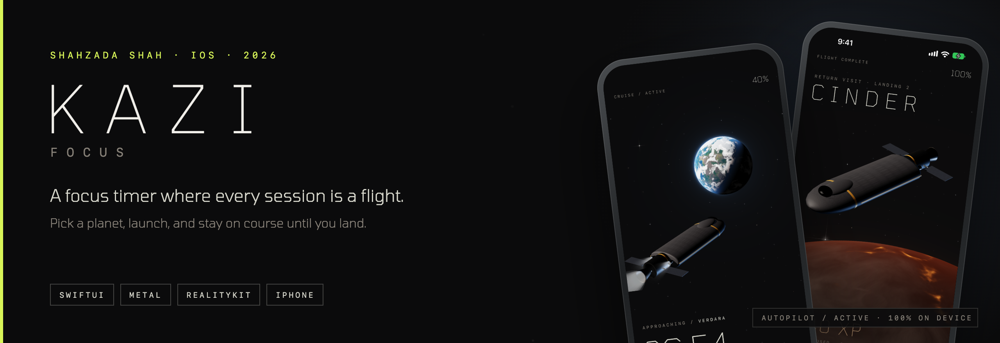

  
  
  
  
  

  <a href="#the-app">The app</a> ·
  <a href="#features">Features</a> ·
  <a href="#on-device">On device</a> ·
  <a href="#worlds">Worlds</a> ·
  <a href="#architecture">Architecture</a> ·
  <a href="#roadmap">Roadmap</a> ·
  <a href="#studio">Studio</a>

> This repository is the public page for **KAZI Focus** by **Shahzada Shah**. The app source is private. Technical write-ups are in [`docs/`](docs).

**For reviewers, in 30 seconds**

- **A real-time renderer in a productivity app.** Planets are drawn live by a Metal shader and lit by the same sun as the 3D ships, loaded in RealityKit.
- **A full progression system.** Ranks from lifetime XP, routes that unlock in order, galaxy systems charted by rank, streaks, planet mastery and nine milestones.
- **Built for a 90-minute screen.** A calm, dim flight view, every looping animation gated by Reduce Motion, and Dynamic Type and VoiceOver throughout.
- **System-level reach.** Live Activity, Dynamic Island, home-screen widgets, Siri and Control Center launch.
- **Privacy as architecture.** No account, no tracking, no ads. Everything stays on the iPhone.

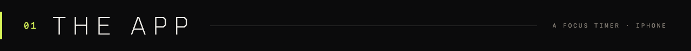

KAZI Focus is an iPhone focus timer. Every session is a flight to a planet. Pick a destination from 25 to 90 minutes, launch, and stay on course until you land. Landing earns XP, charts the next route and moves you up the ranks.

| | |
|---|---|
| **Routes** | 4 · Glacia 25 min, Verdara 45, Cinder 60, Vesper 90 |
| **Ranks** | Cadet to Admiral, from lifetime XP |
| **Galaxy** | 12 systems, two charted per rank |
| **Ships** | 4 hulls, unlocked with XP |
| **Data** | 100% on device · no account |

  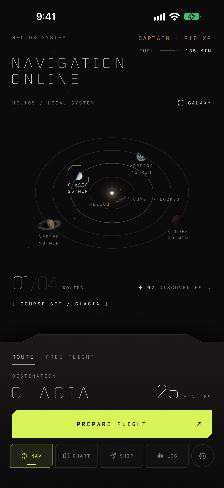
  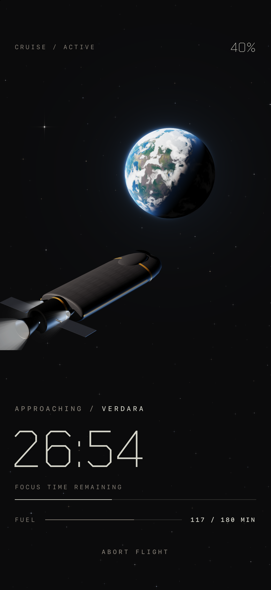

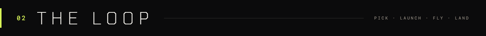

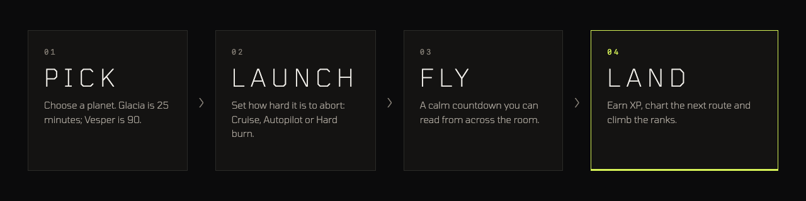

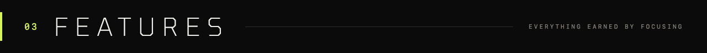

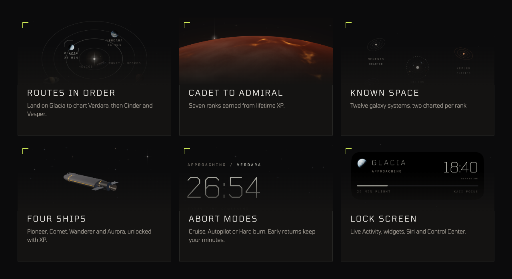

- **Routes in order.** Glacia is open from the start. Landing on it charts Verdara, then Cinder, then Vesper.
- **Cadet to Admiral.** Ranks come from lifetime XP, and each rank charts two more galaxy systems.
- **Four ships.** Pioneer, Comet, Wanderer and Aurora, each unlocked with XP, with an unlock animation.
- **Abort modes.** Cruise, Autopilot or Hard burn sets how hard it is to stop. Returning early keeps your minutes.
- **Discovered worlds.** Free flights end in a new procedural world, from Common to Legendary.
- **Daily fuel.** 180 minutes of flight a day, refilled at midnight.
- **Outside the app.** Live Activity, Dynamic Island, widgets, Siri and Control Center. An optional iOS Focus link silences notifications.

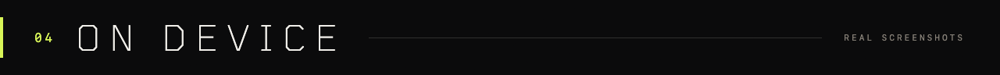

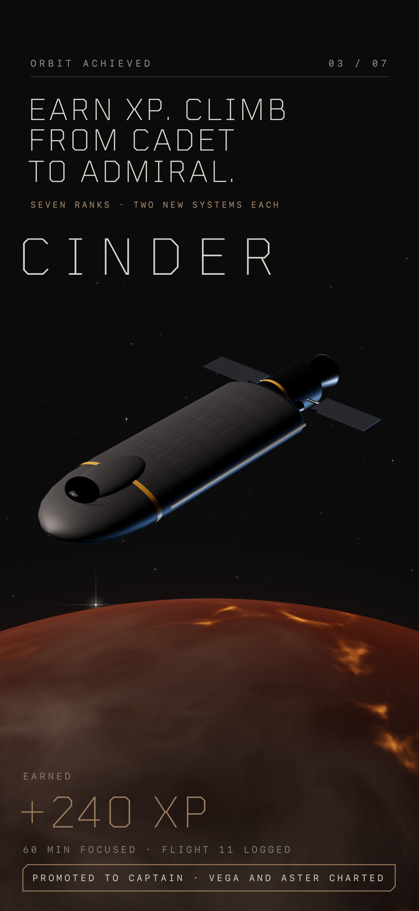

  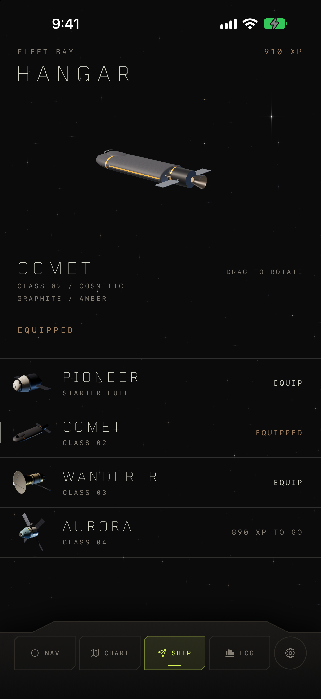
  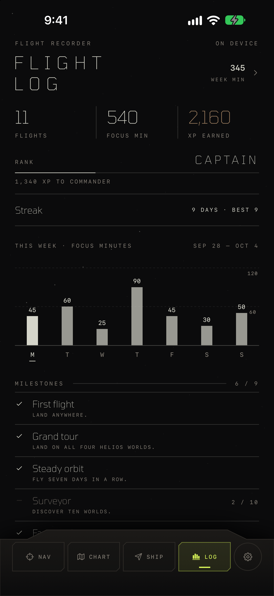
  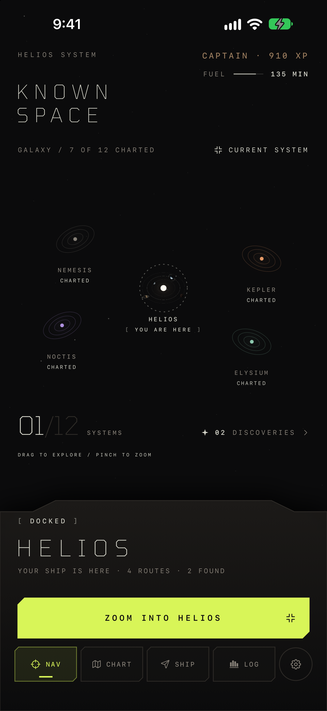

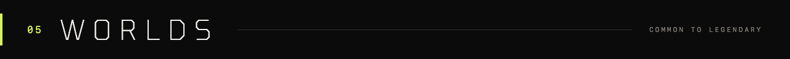

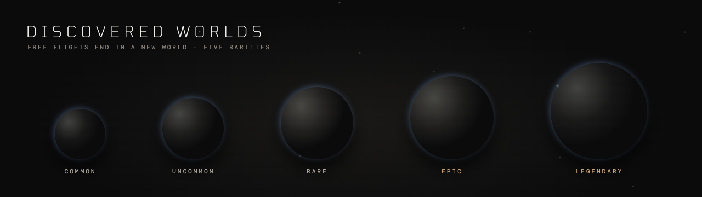
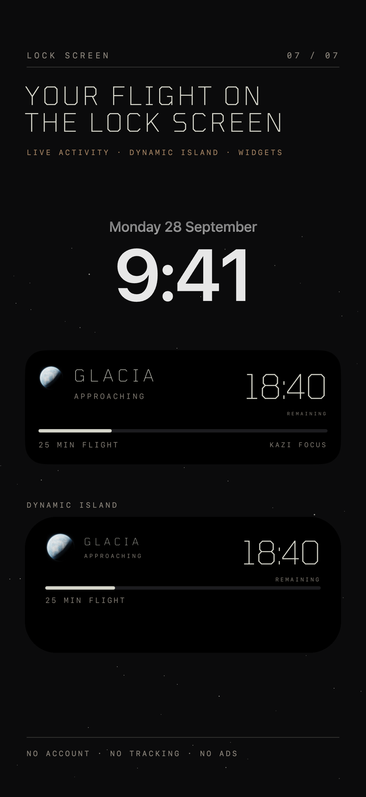

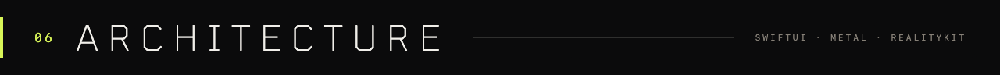

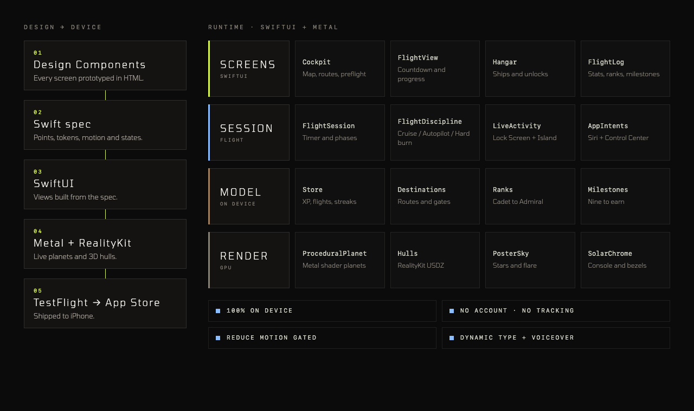

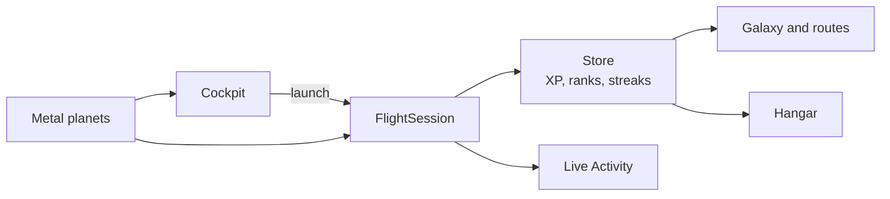

- **Live planets.** A Metal shader renders every planet in real time, with one light direction shared by the planets and the RealityKit ships.
- **Session as a state machine.** `FlightSession` owns the timer and phases (cruise, insertion, arrival, early return) and drives the Live Activity.
- **Progression in one model.** The on-device store derives ranks, galaxy unlocks, route gates, streaks, mastery and milestones from logged flights.
- **Calm by design.** Transform and opacity animation only, and every infinite loop stops under Reduce Motion.

Full write-up: [`docs/ARCHITECTURE.md`](docs/ARCHITECTURE.md)

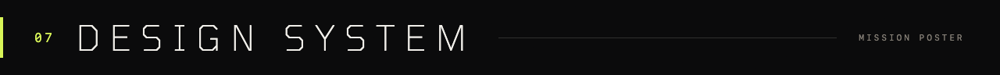

**Mission Poster.** A near-black sky, Tomorrow ExtraLight tracked wide, monospaced readouts, hairline rules, and one lime action per screen.

| Token | Hex | Use |
|---|---|---|
| `sky` | `#0B0B0C` | Every background |
| `text` | `#D5D5CA` | Primary text |
| `muted` | `#868077` | Labels |
| `lime` | `#D8F558` | One action per screen |
| `bronze` | `#9E7F60` | Earned: XP, ranks |
| `salmon` | `#F3A080` | Warnings only |

More: [`docs/DESIGN_SYSTEM.md`](docs/DESIGN_SYSTEM.md)

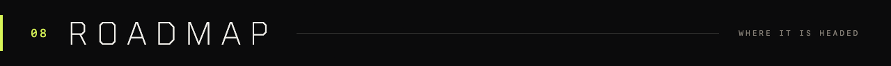

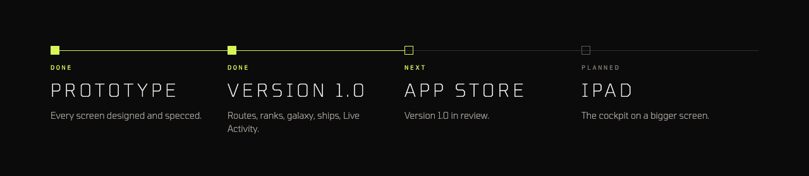

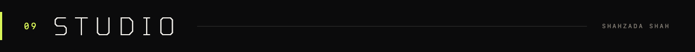

Designed and built by **Shahzada Shah**. For investor, press or hiring enquiries, reach me through this GitHub profile.

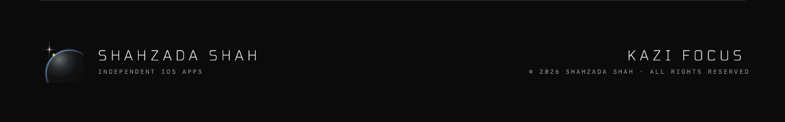

© 2026 Shahzada Shah. All rights reserved. See [LICENSE.md](LICENSE.md) and [CREDITS.md](CREDITS.md).
